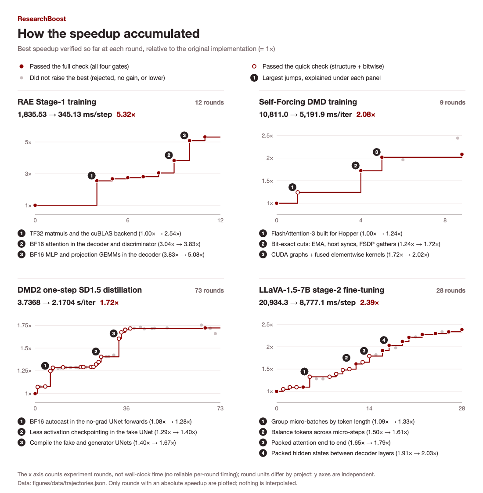
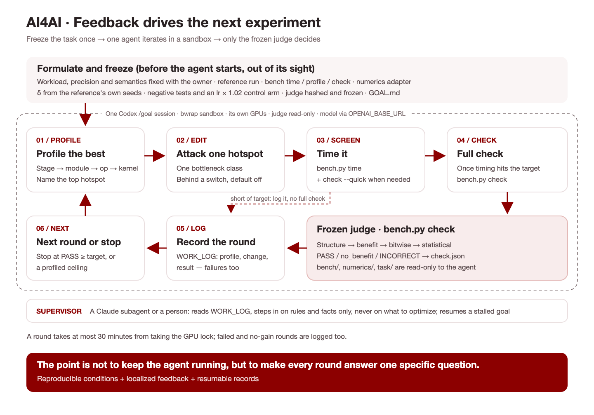

## 1. Introduction

How can agents take part in building AI itself? This question is drawing growing attention. [1] We see recursive self-improvement (RSI), or more broadly **AI4AI**, as a systems problem. It takes more than a new algorithm or model paradigm: agents need an environment where they can work on AI development, receive accurate, detailed, and timely feedback, and use each attempt to guide the next.

A practical starting point is to automate more of a foundation model researcher's work: [2] preparing domain-specific data, building infrastructure and harnesses, running training, and evaluating results. How much of this can agents handle? Where do they get stuck, and what help do they need? Experiment traces, researcher feedback, and data contributed through real-world use can also help us understand how to train the next generation of models for this work.

We chose to start with infrastructure for two reasons:

1. **There is plenty of useful work to do.** From frontier labs to individual researchers, substantial compute goes into repeated experiments, while research code often has room for performance improvements. Optimizing the full training system lets us see whether a faster kernel actually reduces end-to-end experiment time.

2. **The problem has clear boundaries.** With training correctness preserved, we can measure whether an implementation is faster and by how much. This gives us a concrete setting to study how agents find bottlenecks, test changes, and recover from failed attempts. Improvements to widely used open-source projects can also help the community run experiments faster.

**That is why we are launching ResearchBoost.** We started with four projects: RAE [3], Self Forcing [4], DMD (DMD2) [5], and LLaVA (LLaVA-1.5) [6]. Under fixed environments and evaluation protocols, agents iteratively optimized their training code. In the configurations tested, the speedups were **5.32×, 2.08×, 1.72×, and 2.39×**, respectively, with a **geometric mean of 2.60×**. We are open-sourcing the optimized implementations alongside our Infra Optimization Agent so others can use these improvements in their own research.

We will also open a [**ResearchBoost Wishlist**](#wishlist). If training speed is slowing down your project, submit the repository and a runnable configuration. Depending on compatibility and available compute, we will optimize selected projects at no cost and release the improvements to the community.



GitHub: [ResearchBoost-Agent](https://github.com/AI4AI-for-Anything/ResearchBoost-Agent)

## 2. What We Have Done: Making Research Projects Run Faster


*Figure 1. Training speedups relative to each project's original implementation: RAE 5.32×, Self Forcing 2.08×, DMD 1.72×, and LLaVA 2.39×.*



*Figure 2. Optimization trajectories for the four projects. Solid dark-red lines show the best speedup that had passed the full checks at each point; dashed light-red lines show the best result that had passed only the quick checks. Hollow markers and short vertical ticks retain rejected attempts, attempts with no gain, errors, and runs without absolute speedup measurements.*

The traces also show how agents use validation feedback to find problems. In one LLaVA experiment, operator fusion appeared to deliver a 1.46× speedup, but validation found a broken gradient path through the MLP. Restoring backpropagation removed the apparent gain. Another fusion attempt failed a random-state check: the cause was eventually traced to Triton's cache using the global random number generator to create temporary filenames. Once this side effect was isolated, the candidate passed the quick checks and remained in consideration. Feedback helped both rule out gains from missing computation and repair promising candidates.

## 3. How We Do This: An Optimization Loop Built Around Evaluation

For an AI agent to keep improving infrastructure, it needs an experimental environment that keeps giving it useful feedback.

The agent needs to know where the bottleneck is, whether its hypothesis holds, whether a change has broken training semantics, and what to test next. It should keep working toward a clear goal until it reaches the target, exhausts its budget, or encounters a problem that needs human input.

**Good evaluation is what makes this loop work.**



*Figure 3. The AI4AI optimization loop. Each round tests one hypothesis. Evaluation runs on a frozen source snapshot; full evidence is stored outside the context window, with relevant feedback retrieved as needed.*

We look for four properties in an evaluation setup:

- **Fast:** Feedback arrives quickly enough to support more useful experiments within a fixed time and compute budget.

- **Faithful:** Evaluation reflects the target workload, catches errors, and reliably determines whether a change helps.

- **Local:** Feedback points to a specific problem and lets the agent retrieve relevant evidence without filling its context with unrelated information.

- **Dense:** Feedback covers the important stages and states of execution, giving the agent enough information to form its next testable hypothesis.

These properties have to work together. Fast evaluation is of little use if it misses training bugs. Thorough evaluation that takes days per iteration leaves little room to experiment.

### 3.1 Fast & Faithful: Checking Training Correctness Quickly

The first question is: **How do we check that a speedup preserves the numerical behavior of training?**

Running a complete training job after every change is too expensive for frequent iteration. Requiring every result to match bit for bit would rule out many reasonable optimizations. Operator fusion or a different reduction order, for example, can introduce floating-point rounding differences without indicating a bug in the training logic.

We therefore need to distinguish the reference implementation's own stochastic variation from additional deviations introduced by an optimization.

Our approach is to run short training trajectories with the reference implementation under multiple random seeds—for example, the first 100 steps. We record the loss, gradients, and key optimizer states, such as those in Adam, and estimate their standard deviations, σ. This establishes a baseline range of variation, such as 3σ. We then run the optimized implementation under corresponding conditions and check its deviations against the calibrated tolerances.

We organize validation into several layers:

1. **Local checks:** Compare outputs, gradients, and state updates for the modified operators or execution paths using identical inputs, catching obvious errors early.

2. **Short training runs:** Compare training trajectories under fixed configurations, using the variation across reference seeds to assess whether deviations are acceptable.

3. **Longer runs:** Check the final optimized version for cumulative effects that short runs may not reveal.

Short-run evaluation provides screening and feedback for iteration. The evaluation protocol should state which training states it covers, which errors it can detect, and where its limits lie. That gives the agent a clear understanding of what a passing result establishes.

### 3.2 Local & Dense: Feedback That Helps Choose the Next Step

A throughput number tells an agent whether training got faster, but not why. [7]

We use **PyTorch Profiler (torch.profiler), Nsight Systems (nsys), and Nsight Compute (ncu)** to inspect operators, kernels, CPU scheduling, communication, and GPU timelines, narrowing down the bottleneck.

Useful feedback should help the agent answer specific questions:

- Which training stage, operator, or kernel takes most of the time?

- Is the GPU computing, or waiting for data, synchronization, or communication?

- Is a frequently executed path doing necessary work or repeating computation?

- Does a local improvement increase training throughput? Under which input conditions does it stop helping?

- When a correctness check fails, where does the discrepancy first appear—in which tensor, state, or training step?

**Dense feedback provides enough evidence to support the next decision.** Each observation should include a location, a measured result, a comparison point, and a reference to the underlying evidence. Possible causes are recorded separately as hypotheses.

**Local has two meanings here.** First, feedback is tied to a specific stage, code path, input condition, or time interval. Second, evidence is retrieved as needed: full logs and traces stay outside the context window, while the agent starts with a summary relevant to its current hypothesis and follows references for more detail.

This preserves diagnostic depth while keeping context manageable. Profiling runs are also separate from benchmark timing, so profiler overhead does not distort the measured speedup.

## 4. The Agent Harness

We believe capable foundation models can handle much of the analysis, implementation, and experimentation when they have reliable feedback. Our harness focuses on giving each round the context and feedback it needs.

### Evaluation First

Before the agent starts optimizing, we prepare `bench.py`:

1. Run the original implementation and provide three entry points: timing, profiling, and correctness checks.

2. Measure variation across random seeds in the original implementation, estimate standard deviations, and establish tolerances for numerical variation.

Once these are frozen and their hashes recorded, we write `GOAL.md`: the target, the authoritative acceptance criterion, the procedure for each round, and the constraints.

### One Hypothesis at a Time

Each round starts by profiling the current best version. The agent uses that evidence to choose a hotspot or a class of bottlenecks and propose a change.

Testing one hypothesis at a time makes it easier to tell which change caused which result. Whether an attempt succeeds or fails, the agent has a clearer basis for keeping, revising, or abandoning that direction.

### Memory Across Runs

Long optimization runs span multiple context windows. At the end of each round, the agent records its profiling findings, changes, results, and any failure analysis in `WORK_LOG`.

After a session interruption or context compaction, it reads the log and recent evaluation results before continuing. Recording failed attempts helps it avoid repeating work that has already ruled out a direction. Useful improvements are also captured in persistent skills for future projects.

The aim is to make each experiment leave behind evidence and experience the next round can use.

## 5. About Us & Future Work: Supporting More Research

ResearchBoost is our first step toward AI4AI. We want to study RSI through the work researchers already do: preparing data, building infrastructure and harnesses, training models, and evaluating results. As agents take on more of this work, we want to understand which capabilities the next generation of models still needs.

We are continuing with more open-source research projects and commonly used training frameworks, including JiT, Bagel, and Robotwin. Through the [**ResearchBoost Wishlist**](#wishlist), we welcome real cases: repositories, runnable configurations, and bottlenecks you have encountered. Contributions to evaluation, reproduction, and optimization are welcome too. We want these improvements to be useful in other researchers' day-to-day work.

We plan to release an **Infra Optimization Mini-Bench v0.1** soon, then expand it with more reproducible cases. Under fixed correctness requirements, it will compare the speedups different models achieve, the time and budget they spend, and the experiment traces that help explain the differences.

These tasks will also inform training environments for future models. Successful and failed experiments, researcher feedback, and cases contributed by users can all help improve the next generation. ResearchBoost starts with training acceleration; over time, we hope to extend it to data, harnesses, and other parts of research. Bring your projects and problems—we would love to work on them with you.

## References

[1] Anthropic. [When AI builds itself](https://www.anthropic.com/institute/recursive-self-improvement).

[2] Rank, B., et al. [PostTrainBench: Can LLM Agents Automate LLM Post-Training?](https://arxiv.org/abs/2603.08640). 2026.

[3] Zheng, B., et al. [Diffusion Transformers with Representation Autoencoders](https://arxiv.org/abs/2510.11690). arXiv:2510.11690, 2025.

[4] Huang, X., et al. [Self Forcing: Bridging the Train-Test Gap in Autoregressive Video Diffusion](https://arxiv.org/abs/2506.08009). NeurIPS, 2025.

[5] Yin, T., et al. [Improved Distribution Matching Distillation for Fast Image Synthesis](https://arxiv.org/abs/2405.14867). NeurIPS, 2024.

[6] Liu, H., et al. [Improved Baselines with Visual Instruction Tuning](https://arxiv.org/abs/2310.03744). CVPR, 2024.

[7] [Z.ai](http://Z.ai). [Toward Recursive Self-Improvement: How GLM Built Its Own Inference Infrastructure](https://z.ai/blog/glm-built-its-inference-infrastructure). 2026.

## BibTeX

```bibtex
@misc{researchboost2026infra,
  author = {{ResearchBoost Team}},
  title = {{ResearchBoost}: {RSI} starts with Infra},
  year = {2026},
  url = {https://ydove0324.github.io/hx_resume/blog/researchboost/}
}

```

[Download BibTeX](citation.bib)
