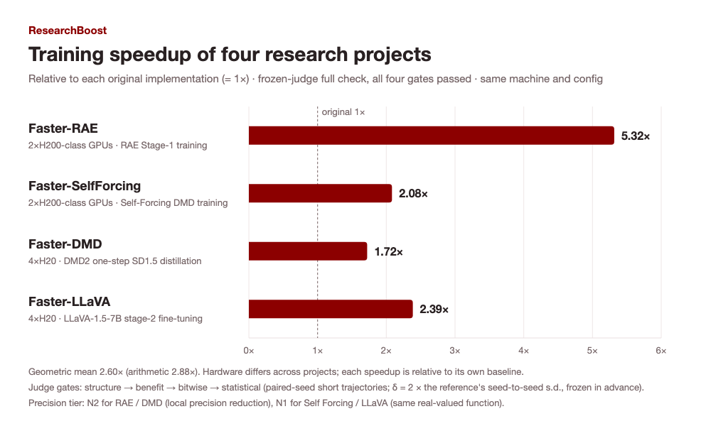
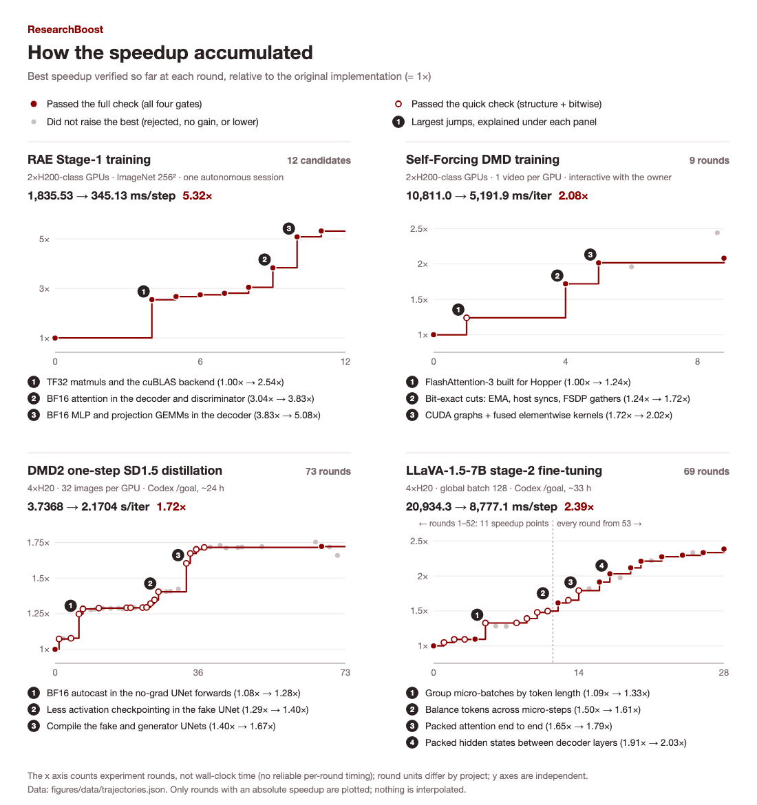
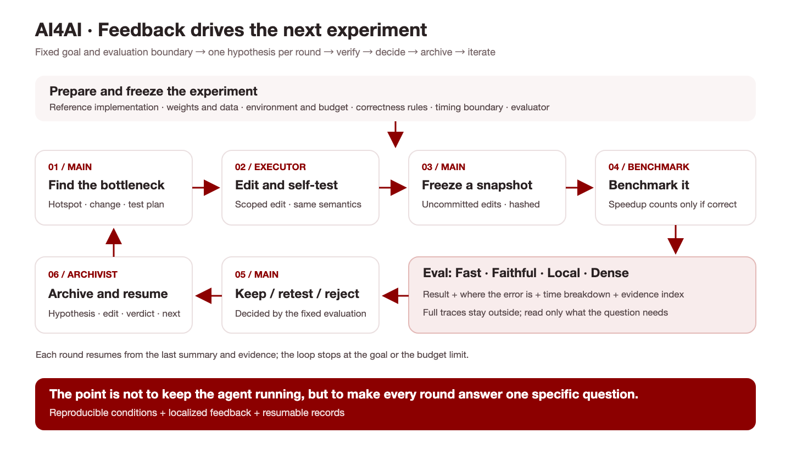

## 1. 序言

如何让 Agent 参与构建 AI 本身，正成为一个越来越受关注的问题[1]。 我们认为，RSI——或者用更广义的叫法，**AI4AI**——应当是一个系统问题，而非某个新的算法或模型范式。它的实现需要一个能让 Agent 持续参与 AI 研发的环境，提供准确、丰富且及时的反馈，让每一轮尝试都能成为下一轮改进的依据。

一个实际的切入点，是让 AI Agent 自动化尽可能多的基模研究员的工作[2], 包括准备特定领域的数据、搭建 infra 和 harness、运行训练、评估结果。这些环节中，有多少可以交给 Agent？它会在哪里遇到困难，需要什么样的帮助？真实任务中的实验轨迹、研究者的反馈和用户回流的数据，也能帮助我们判断下一代模型该如何训练，才能更好地承担这些工作。

我们选择先从 Infra 系统入手:

1. 这个范围足够大：从 frontier lab 到个人研究者，大量算力都花在反复进行的研究实验上，而研究代码常常缺少充分的性能优化。把优化范围扩展到完整训练系统，才能判断单个 kernel 的提速是否真正缩短了端到端的实验时间。

2. 这也是一个边界相对清楚的起点：在保证训练正确的前提下，是否更快、快了多少，都可以通过实验检验。我们希望借此观察模型怎样分析瓶颈、尝试改进、从失败中调整方向；对高频使用的开源项目做出的优化，也能直接帮助社区加快研究迭代。

**这就是我们推出 ResearchBoost 的原因。** 我们先从 RAE [3]、Self Forcing [4]、DMD（DMD2）[5] 和 LLaVA（LLaVA-1.5）[6] 四个项目开始，在固定环境与评测下，让 Agent 持续优化训练代码。在已测试的配置下，四个项目的训练加速比分别为 **5.32×、2.08×、1.72× 和 2.39×**，平均加速为 **2.60×**。我们将优化后的实现与 Infra Optimization Agent 一同开源，让大家能把这些改进用到自己的研究中。

我们也会开放 **ResearchBoost Wishlist**。如果你的项目正被训练速度拖慢，欢迎提交仓库和运行配置。我们会根据适配情况与算力资源，选择项目免费优化，并将成果继续开源给社区。

Github 链接: [https://github.com/AI4AI-for-Anything/infra-opt-agent](https://github.com/AI4AI-for-Anything/infra-opt-agent)

## 2. What We Have Done：让一些高频使用的研究项目跑得更快

*图 1｜四个项目相对原始实现的训练加速比：RAE 5.32×、Self Forcing 2.08×、DMD 1.72×、LLaVA 2.39×，几何平均 2.60×。同一项目的优化前后使用相同机器与配置；项目之间硬件不同，只比较各自的相对加速。*

*图 2｜四个项目的优化轨迹。深红实线表示截至当时通过完整检查的最佳加速比；浅红虚线表示仅通过 quick 检查的最佳值。空心点和短竖线保留被拒、无收益、出错或缺少绝对加速数据的尝试。各子图横轴采用各自的候选序号或交互轮次，不代表墙钟时间，也不能直接跨项目比较。*

这些轨迹也记录了优化中的误判。Self Forcing 曾测出 2.44×，但参考窗口受到其他任务干扰，该结果被作废；DMD 的一个 1.73× 候选改变了跨卡同步行为，被判为 INCORRECT。最终加速比取完整检查通过的结果。

## 3. How We Do This：围绕 Eval 构建持续迭代的闭环

要让 AI agent 持续改进基础设施，关键是构建一个能不断提供有效反馈的实验环境。

Agent 需要知道当前瓶颈在哪里，自己的判断是否成立，改动有没有破坏训练语义，以及下一轮应该验证什么。我们希望它能围绕明确目标持续推进，在达到目标、用尽预算或遇到需要人工处理的问题时停下来。

**支撑这个闭环的核心，是足够好的 Eval。**

*图 3｜AI4AI 的优化闭环。每轮只验证一个假设；评测运行冻结快照，完整证据保存在外部，相关反馈按需进入下一轮上下文。*

我们把好的 Eval 概括为四个特点：

- **Fast**：反馈足够快，让 agent 能在有限时间与预算内完成更多轮有效实验。

- **Faithful**：评测忠实反映目标工作负载，能够发现错误，并可靠判断优化是否有效。

- **Local**：反馈能定位到具体问题，并支持按需读取相关证据，减少无关信息占用上下文。

- **Dense**：反馈覆盖关键阶段和状态，提供足够的信息帮助 agent 形成下一轮可验证的假设。

这四个特点需要一起考虑。评测很快，但漏掉了训练错误，优化就失去了意义；评测足够完整，但每轮都要跑几天，agent 也很难充分迭代。

### 3.1 Fast & Faithful：如何快速判断训练是否仍然正确

训练优化首先要回答一个问题：**如何确认加速没有改变训练的数值行为？**

每次改动后都跑完完整训练，成本过高，难以用于高频迭代。要求所有结果逐 bit 一致，又会排除许多合理优化。例如，算子融合或归约顺序变化可能引入浮点舍入差异；这些差异不一定意味着训练逻辑发生了错误。

因此，我们需要区分两类变化：原始训练本身的随机波动，以及优化实现额外引入的偏差。

我们的验证思路是，先用参考实现在多个随机种子下运行一段较短的训练轨迹，例如前 100 步，记录 loss、梯度及 Adam 等优化器的关键状态，计算对应的标准差 σ，从而建立原始实现的波动范围(如 3 σ )。随后，用优化实现在对应条件下运行，检查其变化是否超出了预先校准的容差。

实际使用中，我们希望把验证分成几层：

1. **局部检查**：对改动涉及的算子或路径，使用相同输入比较输出、梯度与状态更新，尽早发现明显错误。

2. **短程训练检查**：在固定配置下比较训练轨迹，结合多个随机种子建立的基线波动，检查偏差是否可接受。

3. **更长程确认**：对最终优化完的版本，进一步检查短程测试尚未覆盖的累积影响。

短程 Eval 承担的是快速筛查和迭代反馈的职责。它覆盖哪些训练状态、能发现哪些错误、还有哪些边界，都应明确写进评测协议。这样，agent 才能知道一次“通过”究竟支持什么结论。

### 3.2 Local & Dense：让反馈指向下一步行动

一个训练吞吐数字可以告诉 agent 有没有变快，但还不足以告诉它为什么。[7]

为此，我们将性能分析纳入迭代流程，使用 **PyTorch Profiler（torch.profiler）、Nsight Systems（nsys）和 Nsight Compute（ncu）** 等工具，观察算子、kernel、CPU 调度、通信和 GPU 时间线，逐步缩小瓶颈范围。

有用的反馈应该帮助 agent 回答具体问题：

- 主要耗时集中在哪个训练阶段、算子或 kernel？

- GPU 时间花在计算上，还是等待数据、同步或通信？

- 某条路径调用频繁，是必要计算，还是重复工作？

- 局部优化有没有转化为训练吞吐提升？在哪些输入条件下失效？

- 正确性检查失败时，差异最早出现在哪个张量、状态或训练步？

**Dense 的含义，是让关键观察足以支持下一步判断。** 每条反馈尽量包含位置、实际观测、比较基准和证据索引；可能原因则作为待验证的假设单独记录，避免把推测当成事实。

**Local 有两层含义。** 一层是可定位：把问题落到具体阶段、代码路径、输入条件和时间窗口。另一层是按需读取：完整日志和 trace 保存在外部，agent 先看到与当前假设相关的摘要，再沿证据索引查看细节。

这样既保留诊断深度，也能控制上下文中的信息量。性能分析还应与正式计时分开执行，避免 profiler 的额外开销影响加速比。

## 4. Iteration Speed Matters：一个小而明确的 Harness

我们相信，足够强的基础模型在获得可靠反馈之后，能够完成相当一部分分析、修改和实验工作。因此，harness 的设计重点，是让每轮实验都有明确的输入、证据和出口。

围绕这个目标，我们设置了几个基本机制。

### 每轮只验证一个优化假设

开始修改之前，agent 需要说明热点证据、准备改变什么、为什么可能有效，以及怎样验证。

把一轮实验聚焦在一个假设上，可以减少多个改动相互干扰的情况。无论结果成功还是失败，都更容易判断下一步应该保留、调整还是放弃这个方向。

### 冻结候选版本，让结果对应到具体代码

真实评测前，保存包含未提交改动的源码快照，并记录其内容哈希。Benchmark 只运行这份快照，结果也绑定同一个标识。

参考实现、输入资产、评测配置和判分程序保持固定。这样，当一次实验给出加速结果时，我们能明确知道：它测的是哪份代码、哪套条件，而不是一个仍在变化的工作目录。

### 每轮归档，让进度可以恢复

长时间优化会跨越多个上下文窗口。我们要求每轮结束后归档：验证了什么假设、修改了什么、评测结果如何、最终如何决策，以及下一轮从哪里继续。

恢复时，agent 读取简洁的进度摘要，并按需查看原始证据。失败尝试也应记录，因为它们能帮助后续迭代避开已经排除的方向。

### 明确预算、停止条件和回退路径

持续迭代需要明确边界：何时达到目标，何时需要复测，何时拒绝候选，何时因为缺少资产、环境不可用或预算耗尽而停止。

每轮结束后，由主 agent 根据固定评测结果决定保留、复测或拒绝。更换会话时携带已经归档的状态，确保新的上下文能够继续推进同一个任务。

这些机制共同服务于一个目标：**让每轮实验都产生可判断、可追溯、可积累的信息。**

## 5. About us & Future Work：从加速几个项目，到支持更多研究

ResearchBoost 是我们研究 AI4AI 的第一个切入点。我们认为，探索 RSI 需要从研究员每天做的事情开始：准备数据、搭建 infra 和 harness、训练、评测。我们想让 AI 逐步承担更多这些工作，也想弄清楚，下一代模型还需要具备哪些能力。

接下来，我们会继续优化更多开源研究项目和常用训练框架, 我们已经在继续优化包括 JiT, Bagel, Rethinking-OPD, Robotwin 在内高频使用的开源项目。欢迎通过 **ResearchBoost Wishlist** 提交真实 case，包括仓库、运行配置和遇到的瓶颈；也欢迎一起补充评测、复现实验、贡献优化。我们希望这些工作能被更多研究者直接用上。

我们计划很快发布一个 **Infra Optimization Mini-Bench v0.1**，逐步把更多 case 整理成可复现的 benchmark。在固定正确性要求下，比较不同模型能获得多少加速、花费多少时间和预算，并保留实验轨迹，分析差距来自哪里。

这些任务也将用于构建模型训练环境。我们希望把成功与失败的实验、研究者的反馈，以及用户在实际使用中回流的案例积累下来，用于改进下一代模型。ResearchBoost 先从训练加速做起，之后再逐步走向数据、harness 和其他研究环节。欢迎带着你的项目和问题一起参与。

## 参考文献

[1] Anthropic. [When AI builds itself](https://www.anthropic.com/institute/recursive-self-improvement).

[2] Rank, B., et al. [PostTrainBench: Can LLM Agents Automate LLM Post-Training?](https://arxiv.org/abs/2603.08640). 2026.

[3] Zheng, B., et al. [Diffusion Transformers with Representation Autoencoders](https://arxiv.org/abs/2510.11690). arXiv:2510.11690, 2025.

[4] Huang, X., et al. [Self Forcing: Bridging the Train-Test Gap in Autoregressive Video Diffusion](https://arxiv.org/abs/2506.08009). NeurIPS, 2025.

[5] Yin, T., et al. [Improved Distribution Matching Distillation for Fast Image Synthesis](https://arxiv.org/abs/2405.14867). NeurIPS, 2024.

[6] Liu, H., et al. [Improved Baselines with Visual Instruction Tuning](https://arxiv.org/abs/2310.03744). CVPR, 2024.

[7] [Z.ai](http://Z.ai). [Toward Recursive Self-Improvement: How GLM Built Its Own Inference Infrastructure](https://z.ai/blog/glm-built-its-inference-infrastructure). 2026.

---
